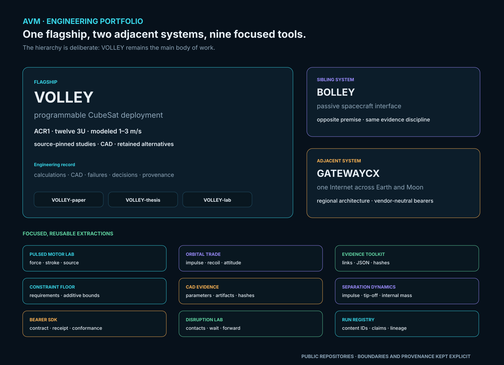

# Adityavardhan Mishra

Mechanical engineering student · Spacecraft deployment, engines and systems software

BTech, Symbiosis Institute of Technology, Pune · 2023–2027

I like problems that survive the first calculation. My main project is **VOLLEY**, an investigation into controlled spacecraft departure from a retained orbital host. It began with a mechanism. The work since has been about finding out whether the mission earns that mechanism.

[Explore VOLLEY](https://aaaaaaaaaaaavm.github.io/VOLLEY/) · [Explore BOLLEY](https://github.com/aaaaaaaaaaaavm/BOLLEY) · [Engineering record](https://github.com/aaaaaaaaaaaavm/VOLLEY) · [Contact](mailto:adityavardhanmishr@gmail.com)

*Project map, updated 25 October 2026. Current VOLLEY engineering reference: VOLLEY-G5-ACR1. Diagrams describe project roles; technical results are linked to their source configuration.*

## Start with the question, then inspect the evidence

| Project | What I am investigating | Useful starting point |
|---|---|---|
| **[VOLLEY](https://github.com/aaaaaaaaaaaavm/VOLLEY)** | Can provider-hosted control of release velocity, direction and timing earn its installed mass and operating burden? | [Current ACR1 package](https://github.com/aaaaaaaaaaaavm/VOLLEY/tree/main/validation/acr1) |
| **[BOLLEY](https://github.com/aaaaaaaaaaaavm/BOLLEY)** | Does a passive spacecraft interface justify its mass by letting the launcher remove the moving sled and return mechanism? | [Selected winding and drive](https://github.com/aaaaaaaaaaaavm/BOLLEY/blob/main/docs/CURRENT_REVIEW.md) |
| **[GatewayCX](https://github.com/aaaaaaaaaaaavm/GatewayCX)** | How should ordinary network applications survive long delays and interrupted Earth–Moon links? | [Architecture and executable software evidence](https://github.com/aaaaaaaaaaaavm/GatewayCX#readme) |

<!-- VOLLEY_PROFILE_START -->
## VOLLEY: commanded deployment with a traceable design record

**VOLLEY-G5-ACR1** is the corrected academic configuration: twelve nominal 4 kg 3U surrogates, guided lead-screw feed into a positively restrained transfer cradle, and a captive reusable launch sled. The current computational package supports a modeled **1–3 m/s** operating range, with 3 m/s as the principal case. Eight frozen native/STEP states and 154 accepted motion/refinement checks document geometry and sequence under the declared conditions.

The current mass basis is **149.55672 kg CAD dry plus 7 kg electrical/control allowance**. This is an academic design with analytical, numerical and geometry evidence. No physical prototype, measured release performance, environmental qualification or provider approval is claimed.

| Edition | Reader route |
|---|---|
| [Main](https://github.com/aaaaaaaaaaaavm/VOLLEY) | Engineering argument, [current source/results and reproduction](https://github.com/aaaaaaaaaaaavm/VOLLEY/tree/main/validation/acr1) |
| [Labs](https://github.com/aaaaaaaaaaaavm/VOLLEY-lab) | Seven-concept feeder trade, alternatives, failed cases and design history |
| [Thesis](https://github.com/aaaaaaaaaaaavm/VOLLEY-thesis) | College report and presentation with their academic evidence |
| [Paper](https://github.com/aaaaaaaaaaaavm/VOLLEY-paper) | Standalone IEEE-formatted manuscript and source package |

**Source/result cutoff: 25 October 2026, ACR1.** Original Gen5 16.029 m/s and finite-geometry 12.448 m/s results belong to earlier models and are not current release ratings. FM08-R3 remains the selected mixed 1U/3U subsystem study; its guided lead-screw principle informs ACR1, but its four-cell geometry is a separate configuration. Gen6 mixed-manifest and high-speed research retains its own inputs and limits.

The mission comparison counts installed device mass, release energy and host maneuvers on matched assumptions. It does not establish a product advantage or an approved customer mission. The host supplies navigation, attitude control and permitted maneuvers; the deployer supplies the release condition.
<!-- VOLLEY_PROFILE_END -->

## BOLLEY: test the neighbouring premise

BOLLEY gives the payload a modelled 0.37136 kg passive magnetic/copper interface while retaining the powered windings and electronics on the launcher. The current 4 kg reference duty is 11.8 m/s over 0.90 m at at most 8 g nominal.

The electrical partition moved from four turns at 380 A to twelve turns at 126.667 A. The first twelve-turn fit failed its copper-volume check; the failure is preserved. The later detailed winding passes its nominal CAD bands, while field distribution, hot switching, manufacturing tolerances and installed mass still need closure.

[Current BOLLEY evidence](https://github.com/aaaaaaaaaaaavm/BOLLEY/blob/main/docs/CURRENT_REVIEW.md) · [What remains unresolved](https://github.com/aaaaaaaaaaaavm/BOLLEY/blob/main/OPEN_PROBLEMS.md)

## Smaller tools extracted from the work

| Repository | Reusable capability |
|---|---|
| [Pulsed Linear Motor Design Lab](https://github.com/aaaaaaaaaaaavm/pulsed-linear-motor-design-lab) | Force, stroke, moving-mass and source-impedance screens |
| [Orbital Deployment Trade Study](https://github.com/aaaaaaaaaaaavm/orbital-deployment-trade-study) | Two-body release, recoil and phase-drift comparisons |
| [Engineering Evidence Toolkit](https://github.com/aaaaaaaaaaaavm/engineering-evidence-toolkit) | Source, result, link and artifact consistency checks |
| [constraint-floor](https://github.com/aaaaaaaaaaaavm/constraint-floor) | Requirement-attributed mass lower bounds |
| [parametric-cad-evidence-pipeline](https://github.com/aaaaaaaaaaaavm/parametric-cad-evidence-pipeline) | Parameter-to-artifact provenance and build manifests |
| [spacecraft-separation-dynamics](https://github.com/aaaaaaaaaaaavm/spacecraft-separation-dynamics) | Impulse, recoil, tip-off and internal-mass screens |
| [gatewaycx-bearer-sdk](https://github.com/aaaaaaaaaaaavm/gatewaycx-bearer-sdk) | Bearer adapters and conformance checks |
| [disruption-network-lab](https://github.com/aaaaaaaaaaaavm/disruption-network-lab) | Scheduled-contact delivery experiments |
| [scientific-run-registry](https://github.com/aaaaaaaaaaaavm/scientific-run-registry) | Content-addressed computational runs and lineage |

These are narrow tools with explicit assumptions. Software tests and model agreement do not establish hardware performance.

## Beyond the repositories

I contributed to Team THRUST's payload-deployment work for the payload that placed second in the SDL Payload Challenge at IREC 2025. I work on Formula Student powertrain, motorcycle engines and ECU calibration, and run Poona Motor Club. Reverse-engineering Powertronic's map format led me to build a dual-map editor.

My engineering work uses Python for numerics and traceability, parametric CAD, field and structural solvers, and independent checks of equations and units. [The skills evidence map](https://github.com/aaaaaaaaaaaavm/VOLLEY/blob/main/docs/SKILLS.md) points to the actual files.

[VOLLEY-paper](https://github.com/aaaaaaaaaaaavm/VOLLEY-paper) holds the standalone IEEE-formatted Gen5 manuscript and evidence package; it has not been submitted. [VOLLEY-thesis](https://github.com/aaaaaaaaaaaavm/VOLLEY-thesis) holds the standalone college review, report, presentation and local evidence. [VOLLEY-lab](https://github.com/aaaaaaaaaaaavm/VOLLEY-lab) preserves exploratory and rejected branches.

[adityavardhanmishr@gmail.com](mailto:adityavardhanmishr@gmail.com) · [LinkedIn](https://www.linkedin.com/in/adityavardhanmishra/) · Pune, India
